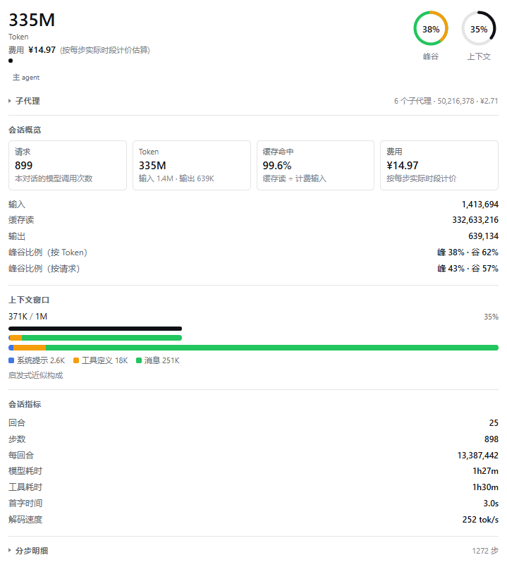
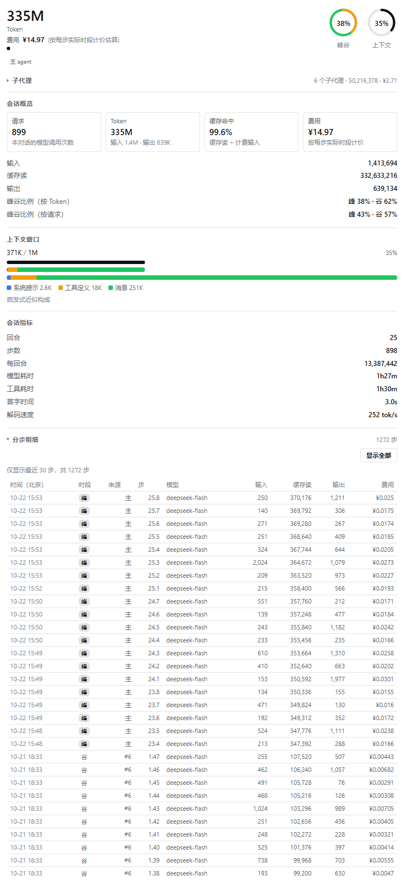
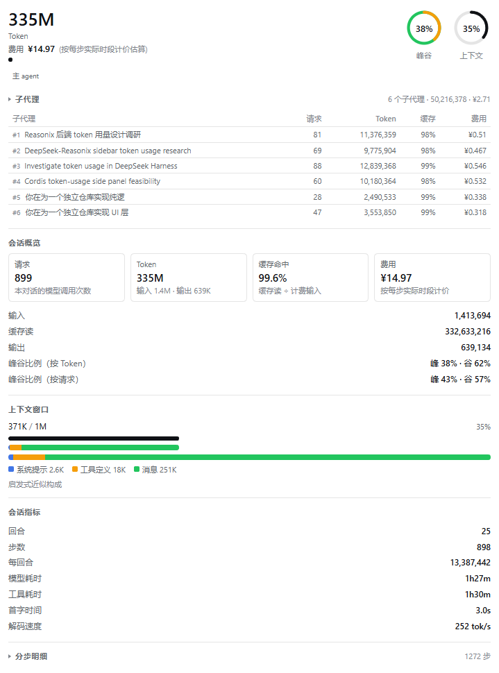
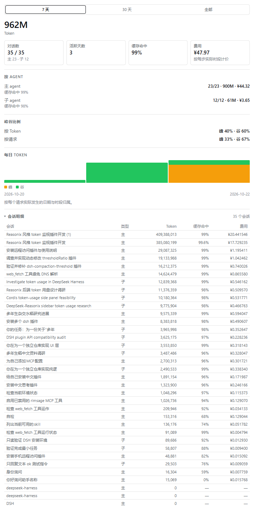

# dsh-usage-insights · DSH 用量洞察

[English](README.EN.md) | 简体中文

在 [DeepSeek Harness](https://github.com/deepseek-ai/deepseek-harness) Web 版的右侧栏里，查看每个对话的 Token 用量、上下文占用、会话指标，以及跨对话的用量汇总与峰谷费用。

这是一个纯展示插件：所有数字都来自 Harness 已经发布的会话投影，插件不写入会话日志、不新增模型可见内容、不上传任何数据。



## 功能

插件在右侧栏提供两个页面。

### 用量（当前对话）

- **会话概览**：请求数、Token 总量、输入 / 缓存读 / 输出（缓存写仅在提供商上报显式缓存写入时显示）、缓存命中率、费用，以及峰谷比例（按 Token 与按请求各一行）。
- **Token 显示**：会话概览的 Token 卡片（含其输入/输出提示）使用 `K` / `M` / `G` 紧凑单位；会话概览的其余行、会话指标、子代理明细与分步明细显示千分位精确整数（如 `275,123,456`）；页头总量、上下文窗口与用量汇总也使用紧凑单位，悬停数字可看到精确值。
- **上下文窗口**：第一行显示已用 / 容量与占用百分比；第二行是按占用比例填充的进度条；第三行是「占用 + 构成」组合条（宽度为占用比例，内部按三色分段）；第四行是整窗构成条；条下是带颜色的图例与各段数值。
- **峰谷圈图**：上下文圈图左侧另有一个圈图，绿色轨道表示空闲、橙色弧线表示高峰，中心显示高峰占比（按 Token）。
- **会话指标**：回合数、步数、每回合 Token、模型耗时、工具耗时、首字时间、解码速度。
- **分步明细**（默认折叠，点击展开）：把主 agent 与直接子代理的请求合并成一条时间线（默认显示最近 30 条，标注总步数），每行包含北京时间、峰谷时段、来源（`主` 或子代理编号 `#1`）、`回合.步`、模型、输入 / 缓存读 / 输出、该步费用。展开后可用「显示全部」开关查看 Host 保留窗口（默认每个会话最近 200 步）内的所有请求。
- **精确峰谷计价**：每个请求按它实际发起时刻所属的时段计价，而不是对整个会话套用单一价格。
- **agent 身份与子代理明细**：面板头部标注该对话是「主 agent」还是「子 agent」；子 agent 显示父对话名称；主 agent 显示直接子代理的数量、合计 Token 与费用，并可展开查看每个子代理的请求数、Token、缓存命中率与费用（按发起顺序编号）。
- 打开主会话的用量页时，缺少峰谷聚合的子代理会自动补读一次（最多 20 个），让明细从区间估算变为按实际时段计价。





### 用量汇总（全部对话）

- 区间切换：最近 7 天 / 30 天 / 全部。
- 总 Token、对话数（已统计 / 总数，附「主 N · 子 M」拆分）、活跃天数、缓存命中率、费用。
- **按 agent**：主对话与子代理分别列出会话数、Token 与费用。
- **峰谷比例**：按 Token 与按请求分别给出高峰/空闲占比（仅统计有峰谷明细的会话，缺失时注明）。
- 每日 Token 柱状图用两种颜色堆叠显示峰谷：橙色为高峰、绿色为空闲，图例随图给出；有分步数据的会话按请求实际发生日期与时段归集，否则回退到「最后活动日」并用灰色标为未分类。
- 缺少分步数据的会话会自动补齐（数量较多时提供「补齐」按钮）。



### 数据持久化与多会话

- Host 半注册两个 Session 投影：`usageSteps`（最近 200 个请求，含开始时刻与峰谷）与 `usageBands`（按天 × 时段 × 模型聚合，保留 90 天、总量终身累计）。
- 两者都由 Harness 的投影缓存 checkpoint：重新打开对话、刷新页面、重启应用后自动恢复。
- 每个会话独立折叠，与浏览器是否打开无关；汇总页读取会话列表里的投影值，后台并行运行的对话也能实时计入。

## 环境要求

- DeepSeek Harness，使用 Web GUI（`dsh web`）。默认 Web 组合已包含 `token-meter` 与 `session-stats`，本插件依赖它们提供的投影。
- 仅从源码构建时需要 Node.js 22+。

## 安装

### 从 GitHub 安装

```sh
dsh plugin install github:Lyoko-Jeremie/dsh-plugin-usage-insights
dsh web
```

### 从本地目录安装

```sh
dsh plugin install /absolute/path/to/dsh-plugin-usage-insights
dsh web
```

也可以把仓库地址发给正在使用的 Harness 会话，让 Agent 用插件管理器安装。

安装后**重启 `dsh web`**：Host 半要在启动时注册投影，仅刷新页面不会生效；随后刷新一次页面加载新的浏览器模块。

### 升级

重新构建并安装后重启 `dsh web`，再刷新页面。

## 打开面板

- **输入框按钮**：消息输入框工具行里、模型选择器左侧的柱状图图标，点一下会展开右侧栏并直接打开「用量」页。
- **右侧栏**：展开右侧栏，点标签栏的 `+`，在指南页选择「用量」或「用量汇总」。

右侧栏默认是收起的，且某些组合会替换会话头部，所以输入框按钮是最可靠的入口。

## 数据来源与口径

| 展示项 | 数据来源 | 说明 |
|---|---|---|
| Token 桶、缓存命中率 | `tokenUsage` 投影 | Provider 上报的精确计数，各桶互不重叠；DeepSeek 不计量缓存写入，因此不显示该行 |
| 上下文已用 / 容量 | `contextPressure` 投影 | 最近一次请求的 prompt 大小（或按会话增量投影）与模型容量 |
| 上下文构成 | `contextBreakdown` 投影 | 启发式近似：系统提示 / 工具定义 / 消息，不是计费值 |
| 回合、步数、模型/工具耗时、首字时间、解码速度 | `sessionStats` 投影 | 来自完整持久日志，翻页与压缩不影响 |
| 分步明细、峰谷、精确费用 | 本插件 Host 投影 `usageSteps` / `usageBands` | 折叠 `step/start`、`assistant/message`、`assistant/attempt` 事件 |
| 费用 | 本插件内置价格表 | 见下文「价格配置」 |

**峰谷规则**（与 DeepSeek 官方文档一致，北京时间）：周一至周五 09:00–12:00、14:00–18:00 为高峰；其余时段、周末以及中国法定节假日全天为空闲（半价）。调休上班的周末仍按空闲计价，因为官方规则按「周一至周五」判定。

费用是**估算**：按配置的价格表对 Token 计数计价，不是官方账单。没有匹配价格的模型会显示「未配置」，而不是 0。

## 主 agent 与子 agent

DSH 把子代理建模为独立会话：子会话的 `origin` 是 `subagent`，`parentSession` 指向父对话，`delegationDepth` 记录层级。插件据此区分：

- **主 agent**：根会话，用量面板显示其直接子代理的合计（数量、Token、费用），并可展开逐个查看（编号、名称、请求数、Token、缓存命中、费用）；分步明细用同一编号标注每个请求属于哪个子代理。
- **子代理编号**：清单与编号来自父会话自己的 `subagent/catalog` 创建记录，按发起顺序分配。之后再发起子代理只会追加新编号，已有子代理的编号不变；子代理的 Token 增长也不会改变排序。子代理离开会话列表后仍保留在清单里，因此不会因为某一行消失而让别人顶替它的编号。
- **子 agent**：子会话，面板显示「子 agent」徽标与父对话名称；其用量同时计入汇总页的「子 agent」行。
- **汇总页**：对话数拆分「主 / 子」，并单独列出两类各自的 Token 与费用。

边界说明：

- **智能体团队的成员按子代理统计**。Agent Teams（实验特性）通过 `subagents.startActivation` 创建成员，成员会话与普通子代理同构（`origin: subagent`，父会话为 Lead），会话头里没有团队字段，因此无法在会话维度把它们与普通子代理可靠区分。
- **请求级来源（压缩、标题、规划等）不计入**。Reasonix 按请求用途（executor / subagent / planner / compaction / title / …）分类；DSH 的会话日志没有这个标签，而且 `compaction-basic` 的摘要调用、`session-title-*-llm` 的标题生成都不写 `assistant/message` 事件，所以本插件的投影看不到这部分消耗。要支持到 Reasonix 那种粒度，需要核心在辅助模型调用处记录来源与用量。

## 价格配置

Harness 不提供货币计价，价格表由插件维护，位于 [`src/client/config.ts`](src/client/config.ts)。内置的是 DeepSeek 官方价格（元 / 百万 tokens，读取于 2026-10-21）：

| 模型 | 时段 | 缓存命中 | 缓存未命中 | 输出 |
|---|---|---|---|---|
| `deepseek-flash` | 高峰 | 0.04 | 2 | 8 |
| `deepseek-flash` | 空闲 | 0.02 | 1 | 4 |
| `deepseek-v4-pro` | 高峰 | 0.30 | 9 | 27 |
| `deepseek-v4-pro` | 空闲 | 0.15 | 4.5 | 13.5 |

修改价格后重新构建：

```ts
export const PRICING: PricingTable = {
  currency: 'CNY',
  prices: [
    { model: 'deepseek-flash', input: 2, cacheRead: 0.04, cacheWrite: 2, output: 8,
      offPeak: { input: 1, cacheRead: 0.02, cacheWrite: 1, output: 4 } },
  ],
  // fallback: { input: 2, cacheRead: 0.04, cacheWrite: 2, output: 8 },
}
```

```sh
npm run build   # 重新生成 dist/client.js
```

计费公式参考 Reasonix：`金额 = Σ tokens × 每百万单价`，每个桶先取整到微单位再相加，避免浮点误差。单时段价格表只产生一个金额；峰谷双档价格表在缺少分步数据时产生区间（下界全按空闲、上界全按高峰），有分步数据时则按实际时段精确计价。

## 法定节假日

DeepSeek 的高峰时段排除中国法定节假日。插件内置 2025–2026 年国务院公告的放假日（经 [`holiday-cn`](https://github.com/NateScarlet/holiday-cn) 提取），并支持两种扩展方式：

```yaml
config:
  useBuiltinHolidays: true          # false = 只用手动配置
  holidays: ['2027-01-01']          # 单个日期
  holidayRanges: ['2027-02-06..2027-02-12']   # 闭区间
```

### 自动同步（可选）

```yaml
config:
  holidaySync:
    enabled: true
    urlTemplate: 'https://cdn.jsdelivr.net/gh/NateScarlet/holiday-cn@master/{year}.json'
    years: []          # 留空 = 北京时间的今年与明年
    timeoutMs: 4000
```

启用后，Host 在启动时拉取对应年份的数据并合并；失败或超时会记录一条警告并回退到内置日历——部分日历会静默把请求归错时段，所以宁可回退也不使用残缺数据。该数据由第三方每日抓取国务院公告维护；不想依赖网络时保持默认关闭即可。

> 官方没有提供「当前离线时段」的查询接口。DeepSeek 文档只以文字定义时段，账户接口也只返回余额，因此插件始终按请求开始时刻 + 北京时间规则 + 节假日日历在本地判定。

## 配置项参考

```yaml
- insert:
    - id: usage-insights
      name: dsh-usage-insights
      config:
        stepHistory: 200            # 折叠保留的请求数（checkpoint 大小）
        stepWindow: 20              # 面板展示的请求数
        bandDays: 90                # 每日聚合保留天数
        useBuiltinHolidays: true    # 使用内置 2025-2026 节假日
        holidays: []                # 额外放假日 YYYY-MM-DD
        holidayRanges: []           # 额外放假区间 YYYY-MM-DD..YYYY-MM-DD
        holidaySync:
          enabled: false
          urlTemplate: 'https://cdn.jsdelivr.net/gh/NateScarlet/holiday-cn@master/{year}.json'
          years: []
          timeoutMs: 4000
```

## 架构

```
Host（index.js）
├── usageSteps 投影：折叠 step/start + assistant/message + assistant/attempt
│     → 最近 200 个请求（时间、回合、模型、四桶、峰谷）
└── usageBands 投影：按天 × 时段 × 模型聚合（90 天 + 终身总量）
        │  Harness 投影缓存 checkpoint（重开/重启恢复）
        ▼
Client（dist/client.js）
├── 「用量」页：读 tokenUsage / contextPressure / contextBreakdown / sessionStats / usageSteps / usageBands
├── 「用量汇总」页：读会话列表中的 usageBands 投影值
└── 输入框柱状图按钮：展开右侧栏并打开用量页
```

- Host 半只做投影折叠与节假日解析，不做任何 UI。
- Client 半不依赖任何 `@deepseek-ai/*` 客户端包，只用平台基线（React）和自己的组件与样式。
- 不新增 Session 事件，不改变会话格式。

## 开发

```sh
npm install
npm run typecheck        # TypeScript
npm test                 # Vitest：计价、峰谷、投影折叠、聚合、格式化
npm run build            # 生成 dist/client.js（Harness module-loader 格式）
npm run verify:bundle    # 在伪造 module loader 下校验注册面
npm run verify:render    # 用真实 React 在 Harness 外渲染两个面板
npm run check            # 以上全部
```

安装到本地 profile 后即可预览：

```sh
dsh plugin install /absolute/path/to/dsh-plugin-usage-insights
dsh web
```

目录结构：

```
index.js              Host 半：注册投影、解析节假日、可选同步
src/host/             投影折叠、节假日解析
src/shared/           峰谷判定（Host 与 Client 共用）
src/client/           注册、面板容器、展示组件、样式、文案
src/lib/              纯函数：格式化、计价、聚合、视图派生
dist/client.js        构建产物（浏览器模块）
assets/               README 截图
```

## 已知限制

- 分步明细是窗口：每个会话的 Host 保留最近 200 条并全部下发给 Client，主/子合并后默认展示最近 30 条，可用「显示全部」查看窗口内所有请求；更早的请求只存在于会话日志中，聚合计数不受影响。
- 每日聚合保留 90 天，更早的天只计入终身总量。
- 2027 年及以后的节假日需要等国务院公告；可手动配置或开启自动同步。
- 极少数失败尝试（`assistant/attempt` 且此前没有成功消息）没有模型路由，按当前会话模型计价。
- 子会话作为独立对话计入汇总；主/子拆分见上文，团队与普通子代理无法在会话维度区分。
- 压缩摘要、标题生成等辅助模型调用不写入会话事件，因此不在用量统计内。
- 费用是基于配置价格的估算，不是官方账单。

## 隐私

- 所有计算在本地完成，插件没有遥测、不上传用量数据。
- 唯一可能的网络请求是可选开启的节假日数据同步，只请求公开的节假日 JSON。

## 致谢

- 价格与峰谷规则来自 [DeepSeek 官方定价文档](https://api-docs.deepseek.com/zh-cn/quick_start/pricing)。
- 节假日数据来自 [`NateScarlet/holiday-cn`](https://github.com/NateScarlet/holiday-cn)。
- 计费与信息层级参考了 Reasonix 的实现思路。

## License

[MIT](LICENSE)
